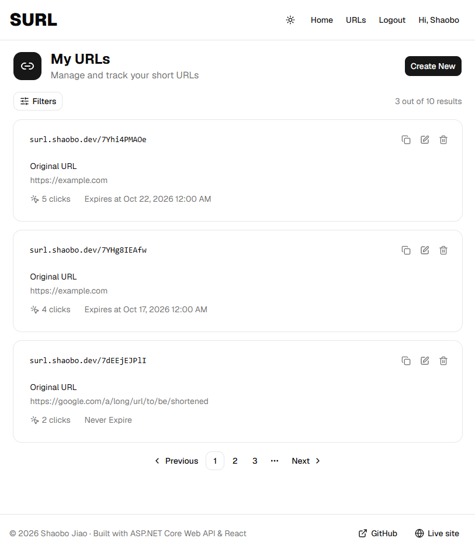
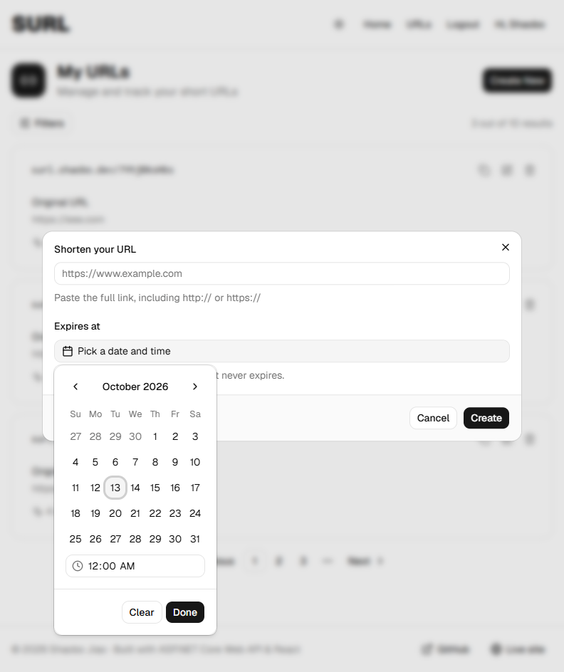
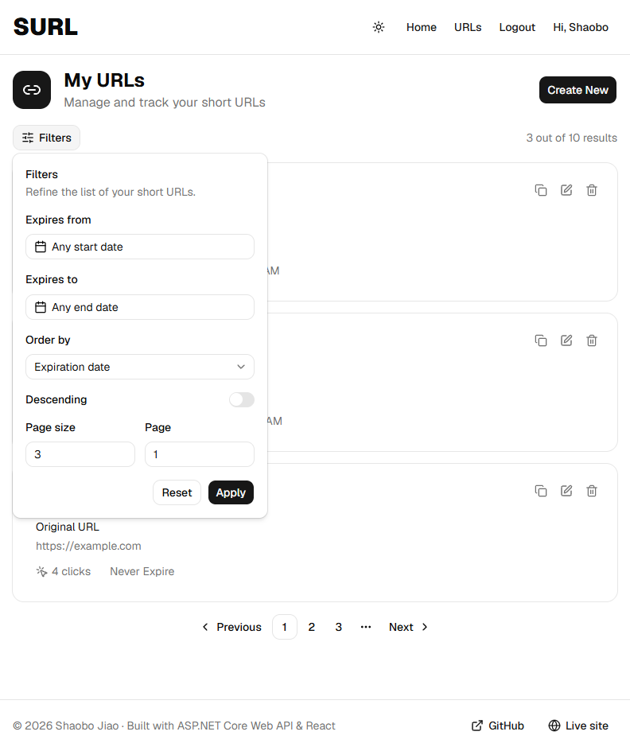
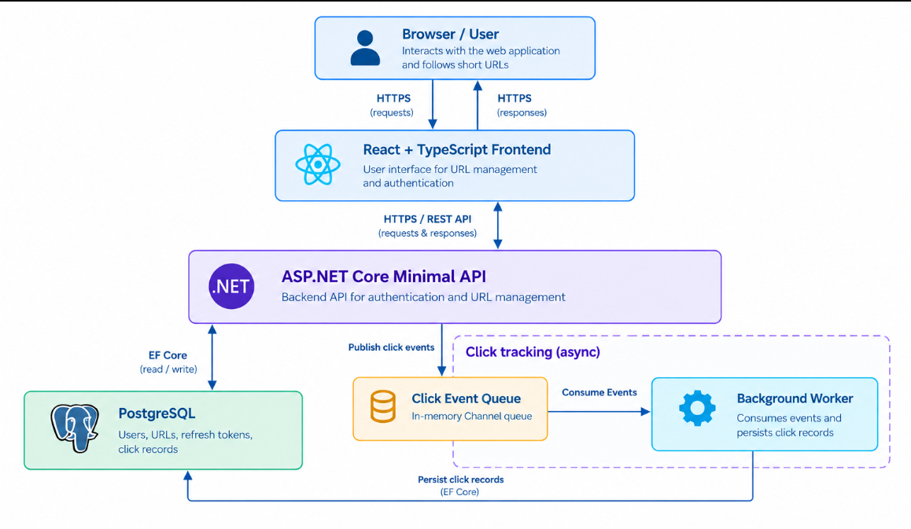

# SURL - URL Shortener

> A URL shortener with authentication, click analytics, and link expiry — built with
> ASP.NET Core Minimal API and React. Live demo at https://surl.shaobo.dev


## Overview
**SURL** is a full-stack URL shortener that allows users to create, manage and share shortened links, with user authentication and click tracking.

- **URL Shortening:** Generates a unique Snowflake-like ID for each shortened URL and encodes it 
  into a compact Base62 short code, producing links such as `https://surl.shaobo.dev/7YHg8IEAfw`.
- **Link Management:** Provides registered users with a personal dashboard to create, edit, and 
  delete links, filter, sort, and paginate their link lists, configure link expiration dates, and 
  view click counts.
- **User Authentication:** Supports user registration, login, logout, password changes, and token refresh 
  using short-lived JWT access tokens and refresh token rotation.

--- 
#### Link Management Dashboard


#### Link Creation & Filtering
<p>
  
  
</p>


## Tech Stack
- **Backend:** ASP.NET Core Minimal API, Entity Framework Core, FluentValidation
- **Database:** PostgreSQL 
- **Frontend:** React, TypeScript, React Router, Tailwind CSS, shadcn/ui
- **Testing:** xUnit, Testcontainers, Respawn
- **Deployment:** Docker, Docker Compose

## Architecture



## Features & Tech Highlights
### Backend Design
- **Short URL ID Generation:** Generates Short URL IDs using a Snowflake-like algorithm with a configurable 
  bit layout (epoch, timestamp/worker/sequence bits), sequence overflow and clock-rollback detection. The IDs
  are Base62-encoded to compact codes (and decoded back) to use in the short URLs.
- **Vertical Slice Architecture:** Organizes backend code into feature-oriented modules (ShortUrls, Users, 
  and Auth), each encapsulating its own entities, endpoints, request and response models, services, errors, 
  and validators.
- **Asynchronous Click Tracking:** Uses a producer-consumer queue and background worker to decouple URL
  redirection from click-event processing and database persistence.
- **Efficient Querying & Pagination:** Implements property-based filtering, sorting with deterministic
  tie-breaking, direct data projection in SQL rather than memory, and offset pagination via a reusable 
  `PagedResult<T>`.
- **Validation & Error Handling:** Runs FluentValidation in a Minimal API endpoint filter `ValidationFilter`.
  Uses `Result<TValue, TError>` service return types instead of throwing, and standardizes error mapping 
  to `ProblemDetails` at the endpoint boundary.

### Auth & Security
- **Token Lifecycle Management:** Uses short-lived JWT access tokens stored in memory and refresh tokens
  stored in `HttpOnly`, `Secure`, `SameSite=Strict` cookies, with refresh token rotation, configurable 
  JWT options and automatic token refresh.
- **Secrets Management:** Uses Docker secrets for sensitive configuration, including database passwords and 
  JWT secrets, rather than passing them as ordinary environment variables
- **Least-privilege Database Roles:** Uses separate database roles for migration and application runtime. 
  The migration role owns the schema, while the application runtime role has only the required DML privileges

### Testing & Delivery
- **Integration Tests against Real Infrastructure:** Integration tests run against PostgreSQL containers via
  Testcontainers with real EF Core migrations and database state reset via Respawn.
- **Deterministic time:** Injects a `FakeTimeProvider` with a matching JWT lifetime validator, so that 
  expiry and refresh-token tests are not time-flaky.
- **Containerization & Delivery:** Uses Docker and Docker Compose configurations with multi-stage build and 
  compose file overlay for development and deployment. Supports health checks and database migration using 
  idempotent migration scripts

### Frontend 
- **Responsive UI and Theming:** Provides a responsive interface for different screen sizes, and supports
  light/dark/system themes


## Project Structure
```text
surl/
├── backend/
│   ├── Surl.Api/                  # Minimal API (Auth, ShortUrls, Users modules)
│   ├── Surl.Api.UnitTests/        # xUnit unit tests
│   └── Surl.Api.IntegrationTests/ # xUnit + Testcontainers + Respawn integration tests
├── frontend/                      # React + TypeScript + Tailwind + shadcn/ui SPA
├── config/                        # Configurations, e.g. nginx config
├── env/                           # DB init script and compose env example
├── secrets/                       # Secret files (only examples committed)
├── docker/                        # Additional Docker files, e.g. db.Dockerfile
├── certs/                         # Dev HTTPS certificates (local only)
├── compose.yaml                   # Base Compose file
└── compose.dev.yaml               # Dev overlay (build + HTTPS)
```


## Getting Started
### Prerequisites
- .NET SDK 10.0
- Docker Desktop / Docker Engine

### Run the App Locally
```bash
# clone the repo
git clone https://github.com/shaobo-jiao/surl.git && cd ./surl

# install dotnet ef if it's not installed
dotnet tool install --global dotnet-ef --version "10.0.*"

# trust asp.net core dev cert if it's not trusted 
# (Linux only: set environment variable SSL_CERT_DIR first) 
# export SSL_CERT_DIR="$HOME/.aspnet/dev-certs/trust:/usr/lib/ssl/certs"
dotnet dev-certs https --trust

# prepare dev cert files:
mkdir certs
dotnet dev-certs https -ep ./certs/localhost.crt --format Pem -np

# prepare necessary secrets
cp ./secrets/postgres_password.example ./secrets/postgres_password
cp ./secrets/surl_owner_password.example ./secrets/surl_owner_password
cp ./secrets/surl_rw_password.example ./secrets/surl_rw_password
cp ./secrets/jwt_secret_key.example ./secrets/jwt_secret_key

# Linux only: set read access to certs and secrets for container non-root users using a user group;
# the user group ID is configurable in the compose file and db.Dockerfile 
sudo groupadd -g 2000 surl-secrets
sudo chown :surl-secrets ./secrets/*
sudo chown :surl-secrets ./certs/*
sudo chmod 640 ./secrets/*
sudo chmod 640 ./certs/*

# generate migration script
dotnet restore ./backend/Surl.Api/
dotnet ef migrations script -i -p ./backend/Surl.Api/ -o ./migrations/db_schema_latest.sql

# start the containers (prepend `sudo` on Linux)
docker compose -f ./compose.yaml -f ./compose.dev.yaml up -d
```
visit the application locally at [https://localhost:5001](https://localhost:5001)

### Run the Tests
```bash
# backend unit and integration tests (integration tests require Docker)
dotnet test ./backend/Surl.slnx

# or use `dotnet run` to run tests 
# prepend `sudo` to run integration tests on Linux as Docker requires it.
dotnet run --project ./backend/Surl.Api.UnitTests/
dotnet run --project ./backend/Surl.Api.IntegrationTests/
```


## Future Work
- **Email Service & Email Registration:** Integrate an email service to support email verification during user registration
- **Rate Limiting:** Implement API rate limiting to prevent abuse and protect endpoints from excessive
  requests.
- **Password Protection:** Allow users to protect shortened URLs with passwords
- **Global Exception Handling Middleware:** Implement centralized exception handling middleware to manage
  unhandled exceptions and return consistent error responses.


## License
Released under the MIT License. See [LICENSE](LICENSE) for details.

